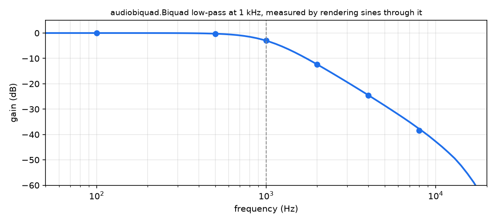

# audiodsp

audiodsp is the part of OmniPython that makes and shapes sound: CircuitPython's audio modules (`audiocore`, `synthio`, `audiomixer` and the effects) with the same import names on MicroPython-compatible boards, CircuitPython-compatible boards and CPython, plus filters, a reverb, a sampler, a Vorbis decoder and an audio pump that CircuitPython doesn't have.

```bash
pip install pydevices-audiodsp
```

```bash
git clone https://github.com/PyDevices/audiodsp ~/build/audiodsp && ~/build/audiodsp/scripts/fetch_deps.sh
```

The first is for a desktop. The second is for a MicroPython firmware build: add `include("/home/you/build/audiodsp/manifest.py")` to your port's manifest, and [Install](docs/get-started/install.md) has the rest.

```python
import array, math, audiobiquad, audiocore

RATE = 48000

def gain_db(freq):
    """Play a sine through a 1 kHz low-pass and report how loud it comes out."""
    sine = array.array("h", (int(16000 * math.sin(2 * math.pi * freq * i / RATE))
                             for i in range(12000)))
    src = audiocore.RawSample(sine, sample_rate=RATE, channel_count=1)
    lp = audiobiquad.Biquad(mode=audiobiquad.LOW_PASS, frequency=1000, Q=0.707,
                            sample_rate=RATE, channel_count=1)
    lp.play(src)
    peaks = [max(map(abs, memoryview(audiocore.get_buffer(lp)[1]).cast("h")))
             for _ in range(40)]
    return 20 * math.log10(max(peaks[20:]) / 16000)   # skip the settling

for f in (100, 1000, 4000, 8000):
    print(f"{f:5d} Hz  {gain_db(f):6.1f} dB")
```

```text
  100 Hz    -0.0 dB
 1000 Hz    -3.0 dB
 4000 Hz   -24.6 dB
 8000 Hz   -38.4 dB
```

[Docs](https://github.com/PyDevices/audiodsp/blob/main/docs/index.md) · [Examples](https://pydevices.github.io/pydevices-examples/gallery/) · [Roadmap](ROADMAP.md)

OmniPython is made by [PyDevices](https://pydevices.com).
