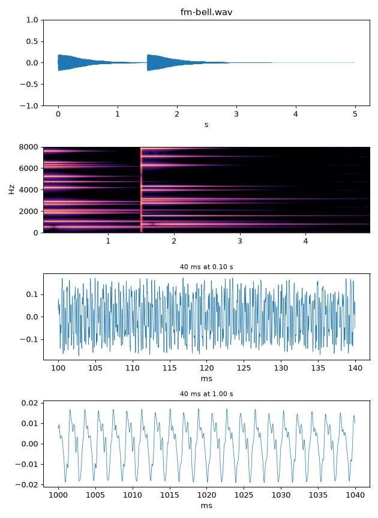

# Play FM voices




Six sine operators per voice, each with its own envelope, wired into one of
32 algorithms where some operators modulate the frequency of others: that is
the FM synthesis of the classic six-operator instruments, and `audiofm` plays
their voice format. Bring a bank of 32 voices, a `.syx` file of 4104 bytes,
and play any voice in it.

```python
import audiofm

with open("bank.syx", "rb") as f:
    bank = audiofm.Patch.bank(f.read())
synth = audiofm.Synth(voices=16, sample_rate=48000, patch=bank[0])
audio_out.play(synth)
synth.press(60, 100)        # note, velocity
...
synth.release(60)
```

A `Synth` is an audio source like `synthio.Synthesizer`: play it into an
output, a mixer voice or an effect. `press()` takes a free voice, or steals the
oldest released one and then the oldest held one when all of them are
sounding. `sustain`, `pitch_bend` (with `bend_range` in semitones) and
`mod_wheel` are the keyboard's controls. The mod wheel adds LFO vibrato and
tremolo on top of the voice's own.

## Edit a voice

Every parameter is an attribute, in the format's own whole numbers, so a value
read off a voice chart goes straight in. `operators[0]` is operator 1.

```python
patch = audiofm.Patch()          # the initial voice: operator 1, a sine
patch.algorithm = 5              # three modulator and carrier pairs
patch.feedback = 6
op = patch.operators[1]          # operator 2 modulates operator 1
op.level = 72
op.coarse = 1                    # ratio 1; 0 is one half
op.rates = (95, 50, 35, 78)
op.levels = (99, 75, 0, 0)
synth.patch = patch
```

`synth.patch` is read at each `press()`, so an edit reaches the next note and
never one already sounding. A value outside its range raises `ValueError`.
`operators[n].enabled = False` mutes an operator without losing its settings.

## Save and load

`patch.pack()` gives the 155-byte voice and `Patch.unpack()` reads it back,
or reads a 163-byte single-voice message with its checksum.
`Patch.pack_bank(patches)` writes up to 32 voices as a 4104-byte bank, and
`Patch.bank()` reads one, checking the checksum. Values past a parameter's
range in a file are clamped rather than refused, so a bank from an old
editor still loads.

```python
with open("mine.syx", "wb") as f:
    f.write(audiofm.Patch.pack_bank(bank))
```

## How loud it is

One note of a loud voice peaks at a sixteenth of full scale or less. That
leaves room for sixteen notes of the loudest voices at once without
clipping. If you play one line at a time and want it louder, raise it in a
mixer.

## What it costs

The engine is fixed point, and an operator whose level is below a tenth of an
LSB isn't computed, so a voice costs what is sounding in it. A released voice
frees itself once every carrier has fallen silent. Rendering is identical on
CPython and MicroPython, which
[`tests/parity/fm_probe.py`](https://github.com/PyDevices/audiodsp/blob/main/tests/parity/fm_probe.py)
checks.

The engine is adapted from Music Synthesizer for Android; what came from where
is in
[`third_party/msfa/ORIGIN.txt`](https://github.com/PyDevices/audiodsp/blob/main/third_party/msfa/ORIGIN.txt).
